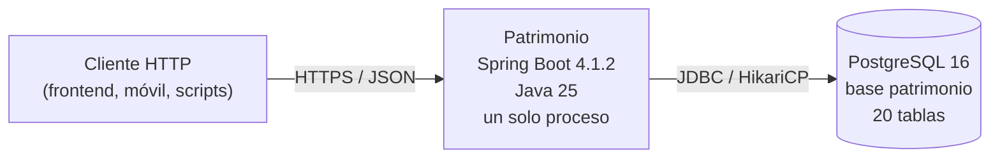
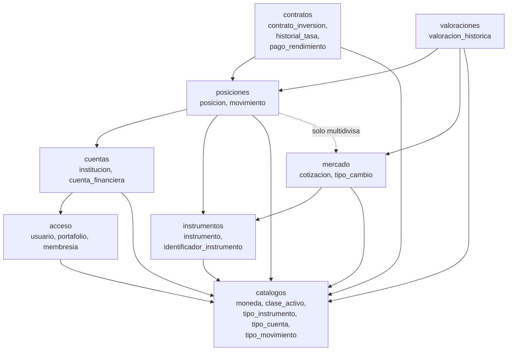

# Patrimonio — Arquitectura general

> Documento de diseño. **No contiene código ejecutable, no crea archivos Java/Kotlin
> y no modifica la base de datos.** Fecha: 2026-10-23.
>
> Estado: propuesta para revisión y aprobación. Las decisiones marcadas como
> *pendientes* requieren confirmación humana antes de implementarse.

## 1. Resumen ejecutivo

Patrimonio se implementará como un **monolito modular** con arquitectura
**hexagonal (Ports and Adapters)** por módulo, sobre **Java 25 LTS** y
**Spring Boot 4.1.2**. Habrá **un único despliegue**: un proceso Spring Boot que
sirve una API REST y accede a una única base PostgreSQL 16.

El dominio de cada módulo será Java puro: sin Spring, JPA, Hibernate, Jackson ni
anotaciones de Jakarta. La persistencia vivirá en adaptadores de salida con
Spring Data JPA/Hibernate. Los controladores REST serán adaptadores de entrada y
nunca devolverán entidades JPA.

El esquema PostgreSQL existente es la **fuente de verdad**. No se usarán Flyway,
Liquibase ni mecanismos equivalentes. Hibernate no creará, actualizará ni
eliminará tablas. Las propuestas `docs/schema-change-proposal.md` y
`docs/schema-change-proposal-v2.md` **no están aplicadas** y no se asumen como
parte del modelo actual.

## 2. Alcance

### 2.1 Dentro del alcance

- Arquitectura de un backend modular único.
- Límites de módulos a partir del esquema real de 20 tablas.
- Puertos de entrada/salida, casos de uso y adaptadores.
- Transformación entre persistencia y dominio.
- Estrategia de persistencia sin migraciones automáticas.
- Estrategia de pruebas y aislamiento de la base de desarrollo.
- Decisiones y preguntas abiertas.

### 2.2 Fuera del alcance

- Implementación de código Java/Kotlin, configuración de build o scripts.
- Cambios de esquema, datos, Docker Compose, contenedores o volúmenes.
- Autenticación/autorización implementadas (Spring Security no forma parte del
  stack solicitado; ver §9.4).
- Frontend, aplicación móvil, reportería avanzada, mensajería, caché distribuida,
  microservicios o event sourcing.
- Aplicación de las propuestas v1/v2.

## 3. Punto de partida real

| Elemento | Estado |
|----------|--------|
| Backend | No existe |
| API REST | No existe |
| Base de datos | PostgreSQL 16, base `patrimonio`, esquema `public` |
| Tablas | 20 |
| Filas | 0 (incluidos catálogos) |
| Restricciones | 78 (20 PK, 28 FK, 12 UNIQUE, 18 CHECK) |
| Índices | 62 (30 explícitos + 32 de PK/UNIQUE) |
| Extensiones | Solo `plpgsql` |
| Migraciones | Ninguna (ni Flyway ni Liquibase) |
| DDL de referencia | `db/esquema.sql` |
| Revisión del esquema | `docs/schema-review.md` / `docs/schema-review.sql` |
| Propuestas | v1 y v2, **no aplicadas** |

Consecuencia: la arquitectura es greenfield, pero el modelo de datos ya existe y
condiciona los módulos. No se inventarán tablas, columnas, relaciones ni
restricciones. Cuando una capacidad dependa de la propuesta v2, se documentará
como **pendiente de aprobación**, no como disponible.

## 4. Decisiones arquitectónicas

| ID | Decisión | Razón | Consecuencia |
|----|----------|-------|--------------|
| AD-01 | **Monolito modular**, un solo despliegue | Tamaño actual, un equipo, una base de datos; evita el coste operativo de microservicios | Un proceso, un `DataSource`, un pipeline; los límites se protegen por paquetes y pruebas |
| AD-02 | **Hexagonal por módulo** | Aísla dominio y casos de uso de Spring/JPA; permite probar sin infraestructura | Cada módulo tiene puertos de entrada/salida y adaptadores propios |
| AD-03 | **Dominio Java puro** | Las reglas de negocio no deben depender del framework ni de la base | El dominio no importa Spring, JPA, Hibernate, Jackson ni Jakarta |
| AD-04 | **Módulos por responsabilidad, no por tabla** | Varias tablas comparten ciclo de vida y lenguaje | 8 módulos; ninguna tabla se convierte automáticamente en módulo |
| AD-05 | **PostgreSQL es la fuente de verdad** | El esquema ya está aplicado y revisado | Hibernate solo mapea; nunca genera DDL |
| AD-06 | **Sin migraciones automáticas** | Restricción explícita del proyecto | Los cambios se revisan, respaldan y aplican manualmente; `db/esquema.sql` se actualiza después |
| AD-07 | **Una transacción por caso de uso** | Límites claros y recuperación simple | `@Transactional` en servicios de aplicación; controladores y repositorios no abren transacciones |
| AD-08 | **DTOs REST, nunca entidades JPA** | Evita acoplar la API al modelo de persistencia | Cada adaptador web tiene sus propios request/response y un assembler |
| AD-09 | **Comunicación entre módulos solo por `api`** | Evita dependencias ocultas y accesos directos a tablas ajenas | Los módulos solo importan `<módulo>.api` y `shared`; no ven `domain`, `application` ni `adapter` ajenos |
| AD-10 | **Shared kernel mínimo** | Evitar abstracciones genéricas innecesarias | Solo IDs tipados, value objects, paginación y excepciones base; sin entidades ni repositorios genéricos |
| AD-11 | **Un proyecto Gradle inicialmente** | Proporcional al tamaño; menos fricción que 8 subproyectos | Paquetes por módulo + reglas ArchUnit; si crece, se separan subproyectos |
| AD-12 | **Sin microservicios, broker, caché ni eventos distribuidos** | No hay requisito que los justifique | Llamadas síncronas en proceso; eventos de dominio solo si aparecen efectos secundarios reales |

## 5. Stack verificado

Versiones comprobadas en fuentes oficiales el **2026-10-23**. No se fijan
versiones de dependencias administradas por el BOM de Spring Boot salvo
justificación documentada.

| Componente | Versión | Origen / nota |
|------------|---------|---------------|
| Java | **25 LTS** (Temurin 25.0.4+101 LTS como parche más reciente) | Adoptium; Java 25 es LTS |
| Spring Boot | **4.1.2** (publicada 2026-10-22) | Última estable; no RC/milestone/snapshot |
| Spring Framework | **7.0.10** | Administrada por Boot 4.1.2 |
| Spring Web MVC | Starter `spring-boot-starter-webmvc` | `spring-boot-starter-web` está deprecado en Boot 4 a favor de `webmvc` |
| Spring Data JPA | **4.1.2** (Spring Data BOM 2026.0.2) | Coordenadas administradas por Boot |
| Hibernate ORM | **7.4.13.Final** | Administrada por Boot |
| Hibernate Validator | **9.1.5.Final** | Administrada por Boot |
| Jakarta Validation | **3.1.1** | Administrada por Boot |
| PostgreSQL JDBC | **42.7.14** | Administrada por Boot |
| PostgreSQL | **16** (`postgres:16`; servidor 16.11 en la revisión) | `docker-compose.yml` / `docs/schema-review.md` |
| Gradle | **9.8.2** (actual); Boot soporta 8.14+ y 9.x | `services.gradle.org`; wrapper fijado |
| JUnit Jupiter | **6.0.3** | Administrada por Boot |
| Mockito | **5.23.0** | Administrada por Boot |
| Testcontainers | **2.0.5** | Administrada por Boot |
| Tomcat | **11.0.27** | Administrada por Boot; Servlet 6.1 |

### 5.1 Requisitos de compatibilidad

- Spring Boot 4.1.2 exige **Java 17 como mínimo** y es compatible hasta
  **Java 27**. Java 25 LTS está dentro del rango.
- Spring Boot 4.1.2 requiere **Spring Framework 7.0.10 o superior** (la versión
  administrada es exactamente 7.0.10).
- Gradle soportado: **8.14 o superior** y **9.x**. Se propone wrapper 9.8.2.
- Contenedor de servlet: **Tomcat 11.0.x / Servlet 6.1**.
- PostgreSQL 16 es el motor objetivo; el driver 42.7.14 es el administrado.

### 5.2 Sobre JUnit 5 y JUnit 6

La pila solicitada menciona **JUnit 5**. El BOM de Spring Boot 4.1.2 administra
**JUnit Jupiter 6.0.3**, que conserva el modelo de programación de Jupiter
(`org.junit.jupiter`) pero es una generación mayor. Se recomienda **aceptar la
versión administrada por el BOM** y documentar la desviación. Forzar JUnit 5.x
obligaría a sobrescribir una versión administrada y a justificar compatibilidad
con Spring Boot 4; no se recomienda sin una razón concreta.

### 5.3 Dependencias no administradas por el BOM

Si se adopta **ArchUnit** para las reglas de arquitectura, no está administrada
por el BOM de Boot: habrá que fijar una versión estable y justificarla. Lo mismo
aplica a cualquier otra librería no incluida en el BOM. No se introducirán
dependencias nuevas sin revisar su compatibilidad con Java 25 y Spring Boot 4.

## 6. Vista de despliegue



- **Un artefacto**: jar ejecutable de Spring Boot.
- **Un proceso**: no hay servicios separados ni comunicación de red entre módulos.
- **Una base**: PostgreSQL 16; el esquema se administra fuera de Hibernate.
- **Sin broker, sin caché, sin bus de eventos**: no hay requisito actual.
- **Configuración por entorno**: variables de entorno; credenciales fuera del
  repositorio (`.env` no se versiona).

## 7. Mapa de módulos



Las flechas indican **dependencia de lectura** a través de `<módulo>.api`; no
implican acceso a tablas ajenas ni asociaciones JPA entre módulos. El detalle y
la matriz completa están en `module-boundaries.md`.

| Módulo | Tablas que posee | Responsabilidad | Tipo |
|--------|------------------|-----------------|------|
| `catalogos` | `moneda`, `clase_activo`, `tipo_instrumento`, `tipo_cuenta`, `tipo_movimiento` | Datos de referencia estables | Soporte |
| `acceso` | `usuario`, `portafolio`, `membresia` | Identidad, portafolios y roles de acceso | Soporte/core |
| `cuentas` | `institucion`, `cuenta_financiera` | Instituciones y cuentas financieras | Core |
| `instrumentos` | `instrumento`, `identificador_instrumento` | Maestro de instrumentos e identificadores | Core |
| `posiciones` | `posicion`, `movimiento` | Tenencias y registro de movimientos | Core |
| `contratos` | `contrato_inversion`, `historial_tasa`, `pago_rendimiento` | Contratos, tasas y pagos de rendimiento | Core |
| `mercado` | `cotizacion`, `tipo_cambio` | Cotizaciones y tipos de cambio | Soporte |
| `valoraciones` | `valoracion_historica` | Snapshots de valoración por posición y fecha | Core |

Total: **8 módulos, 20 tablas**. `valoraciones` es un módulo delgado hoy, pero
tiene ciclo de vida y casos de uso propios; si permanece trivial, la fusión
natural sería con `mercado` (ver `module-boundaries.md`).

## 8. Flujo de una petición

Ejemplo: registrar un movimiento en una posición.

```mermaid
sequenceDiagram
    autonumber
    participant C as Cliente
    participant W as MovimientoController<br/>(adapter.in.web)
    participant U as RegistrarMovimientoService<br/>(application)
    participant D as Posicion / Movimiento<br/>(domain)
    participant P as PosicionRepository<br/>(port.out)
    participant A as PosicionRepositoryAdapter<br/>(adapter.out.persistence)
    participant DB as PostgreSQL

    C->>W: POST /api/v1/posiciones/{id}/movimientos
    W->>W: validar DTO (Bean Validation)
    W->>U: ejecutar(comando)
    U->>P: buscarParaActualizar(posicionId)
    P->>A: findByIdForUpdate(id)
    A->>DB: SELECT ... FOR UPDATE
    DB-->>A: fila
    A-->>P: Posicion (dominio)
    P-->>U: Posicion
    U->>D: registrarMovimiento(...)
    D-->>U: Movimiento + nueva cantidad/precio
    U->>P: guardar(posicion, movimiento)
    P->>A: update + insert
    A->>DB: UPDATE posicion; INSERT movimiento
    U-->>W: resultado
    W-->>C: 201 Created + DTO
```

Puntos clave:

1. El controlador **no** conoce repositorios ni entidades JPA.
2. El caso de uso define el límite transaccional (`@Transactional`).
3. El dominio valida invariantes; la base valida restricciones como última línea.
4. El adaptador de persistencia traduce entre `PosicionEntity` y `Posicion`.
5. La respuesta es un DTO, no una entidad JPA.

## 9. Aspectos transversales

### 9.1 Configuración y perfiles

| Perfil | Base de datos | `ddl-auto` | Uso |
|--------|---------------|------------|-----|
| `local` | Contenedor `docker-compose` | `validate` | Desarrollo diario |
| `test` | Testcontainers PostgreSQL 16 | `validate` | Pruebas automatizadas |
| `ci` | Testcontainers PostgreSQL 16 | `validate` | Pipeline |
| `prod` | PostgreSQL administrado | `none` + validación previa | Producción |

- Credenciales por variables de entorno; nunca en `application.yml`.
- `spring.jpa.open-in-view=false` en todos los perfiles.
- `spring.jpa.generate-ddl=false` explícito.
- No se usa `spring.sql.init` en producción.

### 9.2 Validación

- **Bean Validation** en los DTOs de entrada (`@NotNull`, `@Positive`,
  `@DecimalMin`, `@Size`, etc.) para errores de forma.
- **Dominio** para invariantes de negocio (fechas, signos, estados, coherencia).
- **Base de datos** para restricciones estructurales (PK, FK, UNIQUE, CHECK).
- Las tres capas no se sustituyen: la validación de DTO no reemplaza al dominio,
  y el dominio no reemplaza las restricciones de la base.

### 9.3 Errores

- Excepciones de dominio en `shared.domain`: `DomainException`,
  `NotFoundException`, `ConflictException`, `ValidationException`.
- El adaptador REST traduce a **RFC 9457 `ProblemDetail`** con un código estable
  (`code`), mensaje y, cuando aplique, lista de errores de campo.
- No se exponen stack traces, nombres de tablas, SQL ni entidades JPA.
- Los errores de integridad (`23505`, `23503`, `23514`, `23502`) se traducen en
  el adaptador de persistencia a excepciones de dominio/concurrencia.

### 9.4 Seguridad

- El esquema incluye `usuario.password_hash` y `membresia.rol`, pero **Spring
  Security no forma parte del stack solicitado**.
- La autenticación, el hash de contraseñas y la autorización por rol quedan
  **pendientes de decisión**. No se documenta un flujo de login inventado.
- Mientras no se implemente seguridad, la API no debe exponerse fuera de un
  entorno controlado.
- El usuario de base de datos de la aplicación debe tener permisos DML, **no
  DDL**, para reforzar que Hibernate no puede alterar el esquema.

### 9.5 Observabilidad

- Logs con SLF4J; no registrar contraseñas, hashes ni datos personales.
- Actuator no está en el stack obligatorio; si se añade, limitar endpoints y no
  exponerlos públicamente.
- Métricas y trazas quedan pendientes; no se introducen dependencias sin
  aprobación.

## 10. Estructura de código propuesta

Un solo proyecto Gradle con Kotlin DSL y paquetes por módulo. No se crean aún
archivos de build ni código; esta es la organización objetivo.

```text
com.patrimonio
├── shared
│   ├── domain          # IDs tipados, value objects, excepciones
│   └── application     # PageQuery, PageResult
├── acceso
│   ├── api             # puertos de consulta publicados a otros módulos
│   ├── domain
│   ├── application
│   │   ├── port.in
│   │   ├── port.out
│   │   └── service
│   └── adapter
│       ├── in.web
│       └── out.persistence
├── catalogos
├── cuentas
├── instrumentos
├── posiciones
├── contratos
├── mercado
├── valoraciones
└── PatrimonioApplication
```

Reglas de visibilidad:

- `api`: único paquete importable por otros módulos.
- `domain`, `application`, `adapter`: internos del módulo.
- `shared`: solo value objects, IDs, paginación y excepciones; sin lógica de
  negocio de un módulo concreto.
- No hay un paquete global de “servicios” o “repositorios” que mezcle módulos.

## 11. Atributos de calidad y compromisos

| Atributo | Cómo se aborda | Compromiso |
|----------|----------------|------------|
| Mantenibilidad | Módulos pequeños, lenguaje ubicuo, puertos explícitos | Más interfaces y mappers que un CRUD directo |
| Testabilidad | Dominio sin Spring; puertos simulables; Testcontainers | Infraestructura de pruebas requiere Docker |
| Consistencia | Transacción por caso de uso; restricciones DB | Sin transacciones distribuidas (no hay microservicios) |
| Evolución | `api` estable; módulos desacoplados | Cambiar un contrato público requiere coordinación |
| Rendimiento | Índices existentes; consultas acotadas; sin N+1 | Sin caché ni read models dedicados en la primera iteración |
| Operación | Un jar, una base, configuración por entorno | Un solo proceso escala verticalmente; suficiente para el alcance |
| Seguridad | Pendiente de decisión | No se puede afirmar que la API esté protegida todavía |

## 12. Riesgos y decisiones pendientes

| # | Tema | Riesgo | Decisión necesaria |
|---|------|--------|--------------------|
| 1 | Autenticación/autorización | `usuario` y `membresia` existen, pero no hay stack de seguridad | ¿Spring Security, IdP externo u otra solución? |
| 2 | Relación duplicada posición–contrato | `posicion.contrato_id` y `contrato_inversion.posicion_id` coexisten | Aprobar y aplicar v2 N1, o definir otra vía; mientras tanto se ignora `posicion.contrato_id` |
| 3 | Valoraciones con importes NULL | El esquema actual lo permite | ¿Dominio exige importes y falla si hay NULL, o se modela `Optional`? |
| 4 | Historial de tasas | `fecha`, `fecha_inicio`, `fecha_fin` sin rango ni no-solape | Aprobar v2 N3 (daterange + exclusión/trigger) |
| 5 | Movimientos multidivisa | No hay columnas de importe convertido ni tasa aplicada | Aprobar v2 N5 o definir otra representación |
| 6 | Concurrencia optimista | No hay columna `version` | Usar bloqueo pesimista o aprobar columna `version` |
| 7 | Semántica de movimientos | `tipo_movimiento.categoria` es texto libre y `afecta_posicion` booleano | Definir catálogo, signos y método de coste (FIFO/promedio) |
| 8 | Periodicidades de contrato | `periodicidad_calculo`/`pago` son texto libre sin CHECK | Definir valores permitidos (v2 los propone, no aplicados) |
| 9 | Pago de rendimiento duplicado | No hay UNIQUE natural | Definir idempotencia/clave natural |
| 10 | Módulo `valoraciones` | Una sola tabla hoy | Confirmar módulo propio o fusionarlo con `mercado` |
| 11 | JUnit 5 vs 6 | El BOM administra JUnit 6.0.3 | Aceptar BOM o justificar una versión 5.x |
| 12 | `ddl-auto` en producción | `none` no detecta drift en arranque | Aprobar validación previa en CI/staging |
| 13 | ArchUnit | No está en el BOM | Aprobar dependencia y versión, o usar revisión manual |

## 13. Referencias

- Spring Boot 4.1.2 — release:
  <https://github.com/spring-projects/spring-boot/releases/tag/v4.1.2>
- Spring Boot 4.1.2 — system requirements:
  <https://docs.spring.io/spring-boot/4.1.2/system-requirements.html>
- Spring Boot 4.1.2 — managed dependency coordinates:
  <https://docs.spring.io/spring-boot/4.1.2/appendix/dependency-versions/coordinates.html>
- Gradle — versión actual: <https://services.gradle.org/versions/current>
- Adoptium — releases: <https://api.adoptium.net/v3/info/available_releases>
- Esquema aplicado: `db/esquema.sql`
- Revisión del esquema: `docs/schema-review.md`
- Diagrama ER: `docs/er-diagram.md`
- Propuesta v2 (no aplicada): `docs/schema-change-proposal-v2.md`

## 14. Documentos relacionados

| Documento | Contenido |
|-----------|-----------|
| `hexagonal-architecture.md` | Capas, puertos, adaptadores, mapeo y transacciones |
| `module-boundaries.md` | Módulos, propiedad de tablas, dependencias y reglas |
| `persistence-strategy.md` | Mapeo JPA, `ddl-auto`, repositorios, restricciones y brechas |
| `testing-strategy.md` | Pruebas de dominio, casos de uso, REST, persistencia e integración |
