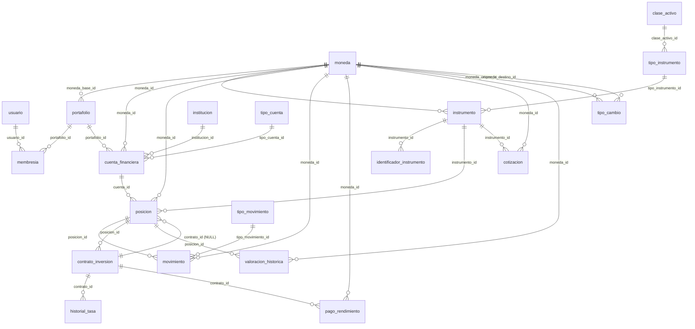
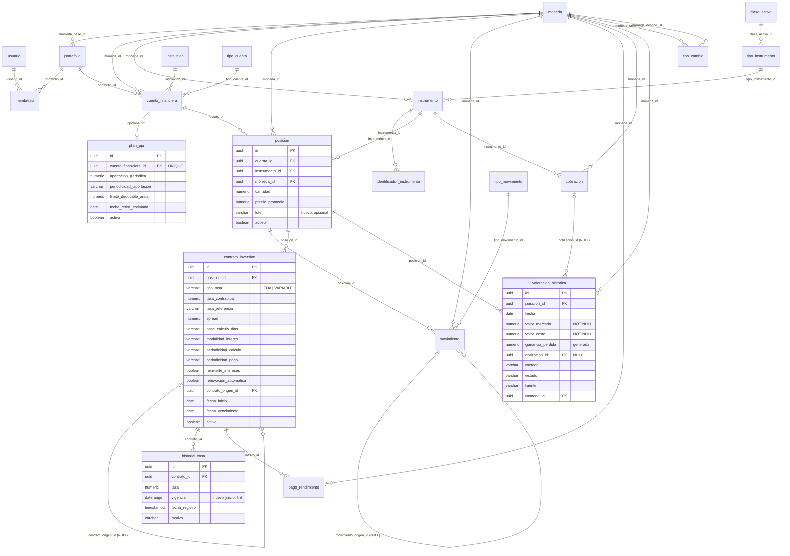

# Patrimonio — Diagramas ER

Este archivo contiene dos vistas del modelo:

- **§1 Estado aplicado**: lo que existe hoy en PostgreSQL (verificado con
  `pg_dump` y el catálogo).
- **§2 Estado objetivo propuesto**: lo que resultaría si se aprueba
  `docs/schema-change-proposal.sql`. **No está aplicado.**

Para el detalle de FK, restricciones e índices del estado actual, ver
`docs/schema-review.md` y `docs/schema-review.sql`.

---

## 1. Estado aplicado (2026-10-23)

20 tablas · 28 FK · 20 PK · 12 UNIQUE · 18 CHECK · 62 índices · 0 filas.

**Relación duplicada:** `posicion.contrato_id` y `contrato_inversion.posicion_id`
representan la misma relación en sentidos opuestos. Ver §2.1.

---

## 2. Estado objetivo propuesto (NO aplicado)

Cambios respecto a §1:

- Se elimina `posicion.contrato_id` (y su FK e índice).
- `contrato_inversion` gana tipo de tasa, referencia, spread, base de cálculo,
  reinversión, renovación y auto-referencia de renovación.
- `historial_tasa` usa un rango `vigencia [inicio, fin)` con restricción de
  exclusión (requiere `btree_gist`, aún no instalada).
- `valoracion_historica` exige importes, deriva la ganancia y registra método,
  estado y cotización de origen.
- `movimiento` gana trazabilidad de reversas y tipo de cambio.
- `plan_ppr` es opcional.

### 2.1 Diferencias concretas

| Elemento | Estado aplicado | Estado propuesto |
|----------|-----------------|------------------|
| `posicion.contrato_id` | Existe (NULL), FK e índice | **Eliminado** |
| FK posición ↔ contrato | 2 vías (`posicion.contrato_id`, `contrato_inversion.posicion_id`) | 1 vía (`contrato_inversion.posicion_id`) |
| Contratos por posición | N (sin restricción de coherencia) | N, con auto-referencia de renovación |
| `contrato_inversion.tasa` | `tasa` NOT NULL | `tasa_contractual` (NULL si variable), + `tipo_tasa`, `tasa_referencia`, `spread` |
| Base de cálculo | No existe | `base_calculo_dias` (`ACT/360`, `ACT/365`, `30/360`) |
| Devengo/pago | Solo periodicidades | + `reinvierte_intereses`, CHECK de reinversión |
| `historial_tasa` | `fecha`, `fecha_inicio`, `fecha_fin` sin coherencia | `vigencia daterange` + `fecha_registro` + `motivo` + `EXCLUDE` |
| Solapes de tasa | Permitidos | Rechazados por el motor |
| `valoracion_historica` | 3 importes NULL, sin metadatos | Importes NOT NULL, `ganancia_perdida` generada, `metodo`, `estado`, `fuente`, `cotizacion_id` |
| `valoracion_historica` ↔ `cotizacion` | Sin vínculo | FK opcional `cotizacion_id` |
| `movimiento` | Sin trazabilidad de correcciones | + `movimiento_origen_id`, `tipo_cambio_aplicado` |
| `tipo_movimiento` | Sin naturaleza | + `naturaleza` (`ENTRADA`/`SALIDA`/`NEUTRA`/`AJUSTE`) |
| `posicion` | Sin etiqueta de lote | + `lote` (opcional) |
| PPR | Solo como cuenta/instrumento | Igual + `plan_ppr` opcional |
| Vistas | Ninguna | `v_contrato_tasa_vigente` (opcional) |

Si se aplicara todo, el número de FK sería 31: 28 − 1 (`posicion.contrato_id`) +
4 nuevas (`valoracion_historica.cotizacion_id`, `contrato_inversion.contrato_origen_id`,
`movimiento.movimiento_origen_id`, `plan_ppr.cuenta_financiera_id`).

**Nada de esto está aplicado.** El estado real sigue siendo el de §1.
